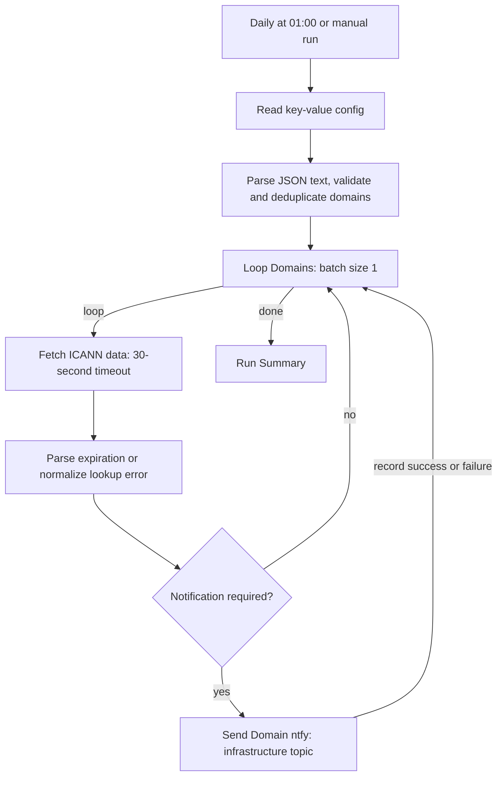

# Domain expiration — configured domains

Import **Domain expiration - Configured domains.json** to run all configured domains in one workflow. One daily execution loads the domain list from PostgreSQL and checks each domain in order, including its optional ntfy notification, before starting the next. All alerts and lookup errors use `NOTIFICATIONS_INFRA_ISSUES_TOPIC`. There are no staggered schedules or waits.

Repository-wide architecture and compatibility notes live in [AI_CONTEXT.md](../../AI_CONTEXT.md#domain-expiration--configured-domains).

## Files

- [Domain expiration - Configured domains.json](<Domain expiration - Configured domains.json>): the single importable workflow, exported inactive.
- [config.example.sql](../../database/domain-expiration/config.example.sql): domain configuration insert/upsert example; notification settings reuse the existing ntfy keys.
- [test-domain-expiration.cjs](test-domain-expiration.cjs): offline checks for the embedded Code nodes and workflow routes.

## Flow



The schedule is `0 1 * * *`, using the workflow/instance time zone, as the original 01:00 check did. Confirm the intended time zone in n8n settings when importing. The domain array determines processing order; each normalized domain is checked once per execution.

## Configuration

The existing [table schema](../../database/table_key_value_store.sql) uses `name` for the key and **`data TEXT` for the value**. No schema change or JSON column is needed.

| Key | Value in `data` |
| --- | --- |
| `DOMAIN_EXPIRATION_CONFIG` | A JSON object serialized as a string; `domains` is required. |
| `NOTIFICATIONS_BASE_URL` | Required ntfy base URL, shared with the weather/calendar workflows. |
| `NOTIFICATIONS_INFRA_ISSUES_TOPIC` | Required ntfy topic for every expiration alert and lookup/parsing error. |
| `NOTIFICATIONS_USER` | Optional HTTP Basic username; configure together with the password. |
| `NOTIFICATIONS_PASSWORD` | Optional HTTP Basic password; configure together with the username. |

The username and password may both be empty or absent. If either is configured, both must be configured. The workflow trims the base URL, trailing slashes, topic, and username, while preserving the password as stored. `PERSONAL_TELEGRAM_CHAT_ID` and Telegram bot credentials are no longer read by this workflow.

For example, the JSON object stored inside `DOMAIN_EXPIRATION_CONFIG.data` can contain:

```json
{
  "domains": [
    "aramburo.dev",
    "laziness.rocks",
    "perfildelinversionistainverplux.com"
  ]
}
```

When writing from application code, set `data = JSON.stringify(config)`. Serialize once: do not store a JSON string containing another JSON string. The workflow calls `JSON.parse(row.data)` after reading the text value.

Sample insert matching the SQL example's domain list:

```sql
INSERT INTO public.key_value_store (name, data, description)
VALUES (
    'DOMAIN_EXPIRATION_CONFIG',
    '{"domains":["laziness.rocks"]}'::jsonb::text,
    'Domain expiration monitor: serialized JSON domain list and optional lookupUrl'
)
ON CONFLICT (name) DO UPDATE
SET data = EXCLUDED.data,
    description = EXCLUDED.description;
```

The `::jsonb::text` casts validate the SQL literal as JSON and store the serialized result as text. The [SQL example](../../database/domain-expiration/config.example.sql) seeds only domain configuration and reuses the existing ntfy settings. Extend its array for your installation before running it. Re-running the domain upsert replaces the entire list; switching an existing workflow to ntfy does not require re-seeding its domain list.

To add or remove a domain, edit this array in the database; the next run reads the updated value. No workflow edit or separate workflow import is required. Use an empty array, `{"domains":[]}`, to pause all domain checks; the execution stops at configuration parsing without lookups, notifications, or a run summary.

Domain entries must be bare DNS names, with no scheme, path, query string, or port. Internationalized names must use punycode. Names are trimmed, lowercased, and stripped of one trailing dot; duplicates are removed while preserving their first position. The complete list is validated before any lookup starts. Missing keys, malformed JSON, an invalid domain entry, an invalid ntfy base URL, or incomplete Basic authentication settings fail the execution at **Parse Domain Config**.

The optional string `lookupUrl` overrides the default endpoint:

```json
{
  "domains": ["aramburo.dev"],
  "lookupUrl": "http://srv-captain--selenium-service:8000/v1/icann/lookup"
}
```

Supply an absolute HTTP(S) endpoint without credentials, query parameters, or a fragment. The HTTP Request node adds an encoded `domain` query parameter. The existing internal Selenium/ICANN service and its HTML response contract remain the lookup source.

## Alerts and errors

The original alert thresholds are preserved. Every notification publishes to `NOTIFICATIONS_INFRA_ISSUES_TOPIC`:

| Days remaining | Action | ntfy priority |
| --- | --- | ---: |
| Exactly 60 | Renewal reminder. | 3 |
| Exactly 30 | Renewal warning. | 4 |
| Exactly 15 | Urgent warning. | 4 |
| 10 or fewer | Critical warning on every run. | 5 |
| All other values | No expiration notification. | — |
| Request or parsing failure | Error notification. | 4 |

Days remaining are `max(0, floor((expiration timestamp - check timestamp) / 86400000))`, preserving the original calculation. The parser accepts `YYYY-MM-DD HH:mm:ss UTC` and ISO UTC timestamps such as `2027-01-01T12:00:00Z` (with optional milliseconds), and rejects invalid dates. It reads a `span` whose classes include both `date` and `registry-expiration`, tolerating class order, additional attributes, and either quote style. The response can be raw HTML or a JSON envelope with an HTML string in `data`.

Expired domains have zero days remaining and receive an explicit expired-domain message. A domain expiring within 24 hours also has zero floored days, but is not marked expired until its expiration timestamp passes.

A 30-second lookup timeout, network failure, non-2xx response, missing expiration span, or invalid date produces a per-domain error and continues the loop after attempting its ntfy notification. ntfy sending failures also continue the loop and appear in the summary.

## ntfy publishing

**Send Domain ntfy** follows the weather workflow's publishing pattern: `this.helpers.httpRequest` sends HTTP `POST` to `NOTIFICATIONS_BASE_URL` with a JSON body containing `topic`, `title`, `message`, `priority`, and `tags`. The topic is supplied in the body, not appended to the URL. A configured username/password pair generates an HTTP Basic `Authorization` header; otherwise the header is omitted. No separate n8n HTTP credential is required.

The title includes the domain and alert type. Messages are plain text, with no Telegram HTML escaping. Reminder messages use the `calendar` tag, critical messages use `rotating_light`, and lookup errors use `warning`.

Each publish has a 20-second timeout. Only HTTP 2xx counts as sent. HTTP and network failures are recorded as `notification.status: "failed"` before the next domain is checked. Notification metadata includes `provider: "ntfy"`, topic, HTTP status (or null), type, and any delivery error; notification credentials are not copied into per-domain results or the summary.

There is no persistent notification state. Manual runs can repeat alerts, critical alerts repeat every day, and exact 60/30/15-day reminders missed during downtime are not backfilled. **Manual Test** runs the normal notification path and can send real messages.

## Import and migration

1. Confirm the shared ntfy keys listed above exist in the automation database. For a new installation, seed `DOMAIN_EXPIRATION_CONFIG` using [config.example.sql](../../database/domain-expiration/config.example.sql), adjusting its domain list first. Keep the stored domain list when updating an existing monitor.
2. Update the existing workflow with **Domain expiration - Configured domains.json**, or import a replacement and deactivate its previous copy.
3. Reselect the local `automation-db` PostgreSQL credential in **Get Domain Config**.
4. Confirm the n8n worker can reach both the internal lookup service and ntfy, and that the shared notification account can publish to the infrastructure topic.
5. Confirm the schedule uses the intended time zone. On an initial migration, deactivate **Domain expiration - aramburo.dev**, **Domain expiration - laziness.rocks**, and **Domain expiration - inver** in n8n. Replacing repository exports does not deactivate deployed copies.
6. Run **Manual Test** and inspect **Run Summary**. It should report every configured domain; investigate any lookup or notification failures.
7. Activate the updated workflow.

The old per-domain exports have been replaced in this repository; their previous versions remain available in Git history. Database changes, n8n import, and activation are deployment steps and are not performed by editing these files.

## Execution output and validation

**Run Summary** returns `status` (`ok` or `partial_error`), `checkedCount`, `lookupErrorCount`, `expirationAlertsSent`, `errorNotificationsSent`, `notificationFailureCount`, `completedAt`, and per-domain `results`. Results include expiration timestamps, floored days, the alert level, request/parse errors, and notification status (`not_required`, `sent`, or `failed`). There is no daily success message. A handled failure can leave the n8n execution successful while the summary reports `partial_error`; database/configuration failures fail the execution directly.

Run the local checks with:

```bash
node --test workflows/domain-expiration/test-domain-expiration.cjs
```

These checks execute the exported Code nodes with mocked n8n inputs and route mixed outcomes through the exported graph. They cover JSON text config, normalization, alert boundaries, UTC/date parsing, lookup failures, ntfy JSON/topic/authentication/priority, failed delivery, and continuation to later domains. They do not connect to PostgreSQL, the lookup service, ntfy, or a live n8n instance; complete the import/manual check for runtime verification.

The loop uses n8n's documented [Loop Over Items](https://docs.n8n.io/integrations/builtin/core-nodes/n8n-nodes-base.splitinbatches/) behavior with batch size 1. The lookup uses [HTTP Request](https://docs.n8n.io/integrations/builtin/core-nodes/n8n-nodes-base.httprequest/) full text responses so HTTP status and parsing errors can be handled separately.

Notification publishing follows the local [weather workflow](../weather-notifications/README.md#ntfy-delivery-behavior) and ntfy's documented [JSON publishing](https://docs.ntfy.sh/publish/#publish-as-json) and [authentication](https://docs.ntfy.sh/publish/#authentication) contracts.
